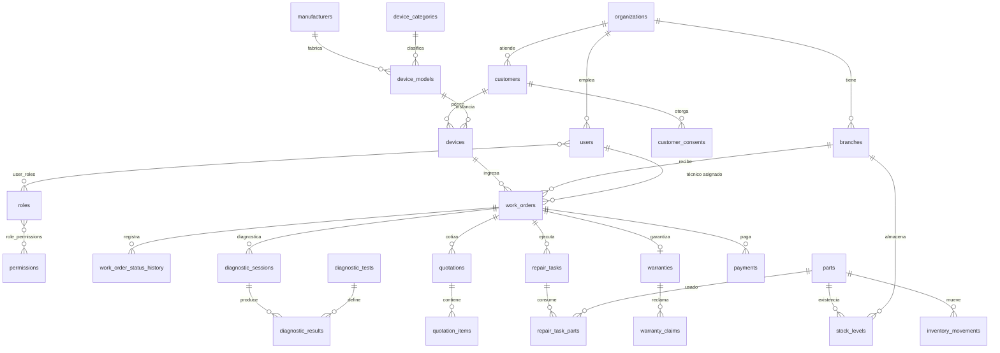

# ERMS – Modelo entidad-relación

Estado de cada entidad: **✅ migrada** · **📐 diseñada** (se migra en el sprint indicado).

Todas las tablas tienen `id UUID PK`, `created_at timestamptz` y `updated_at timestamptz`. Las
tablas de negocio tienen además `organization_id UUID NOT NULL FK → organizations` con índice.

## 1. Diagrama (núcleo)

## 2. Entidades

### Identidad y organización

| Tabla | Sprint | Columnas clave | Restricciones |
|---|---|---|---|
| `organizations` | ✅ 0 · 2 | name, slug, tax_id (NIT), timezone, is_active; desde el Sprint 2: legal_name, address, city, phone, email (responsable del tratamiento); desde el Sprint 6: warranty_days (90 por defecto); desde E1: assembly_bottleneck_gap (25), assembly_min_ram_gb (16) y, desde 0009, assembly_margin_percent (15) | `uq(slug)` |
| `branches` | ✅ 1 | name, city, address, phone, is_active | `uq(organization_id, name)` |
| `users` | ✅ 1 | email, full_name, phone, password_hash, must_change_password, is_active, failed_login_count, locked_until, last_login_at, password_changed_at | `uq(email)` **global**; `ck(email = lower(email))` |
| `roles` | ✅ 1 | code (ADMIN, SUPERVISOR, TECHNICIAN, RECEPTIONIST), name, is_system | `uq(organization_id, code)` |
| `permissions` | ✅ 1 | code (`users:read`…), description | `uq(code)`; catálogo global insertado por migraciones |
| `user_roles`, `role_permissions` | ✅ 1 | tablas puente | PK compuesta; índice por la segunda columna |
| `refresh_tokens` | ✅ 1 | user_id, family_id (sesión), token_hash (SHA-256), expires_at (inactividad), session_expires_at (absoluta), revoked_at, replaced_by_id, ip, user_agent | `uq(token_hash)`; índices por user_id y family_id |
| `password_reset_tokens` | ✅ 1 | user_id, token_hash (SHA-256), expires_at, used_at | `uq(token_hash)` |
| `audit_logs` | ✅ 1 | organization_id, actor_user_id, action, entity_type, entity_id, changes JSONB, ip, user_agent, created_at | solo inserción; índices (entity_type, entity_id), (organization_id, created_at), action, actor |

### Clientes y dispositivos

| Tabla | Sprint | Columnas clave | Restricciones |
|---|---|---|---|
| `privacy_policies` | ✅ 2 | version, content, published_at, published_by_id | `uq(organization_id, version)`; versiones inmutables |
| `customers` | ✅ 2 | kind (PERSON/COMPANY), full_name, search_name (sin tildes), id_type (CC, CE, NIT, PAS, TI, PPT), id_number, phone (E.164), email, address, notes, is_active, anonymized_at, created_by_id | `uq(organization_id, id_type, id_number)` (documento opcional); `ck` tipo y número juntos; índice GIN trigram (`pg_trgm`) por `search_name` |
| `customer_consents` | ✅ 2 | customer_id, purpose (DATA_PROCESSING, PHOTOS, DIAGNOSTIC_AGENT), granted, channel (SCREEN, PAPER, VERBAL), policy_id, recorded_by_id, recorded_at | Ley 1581 de 2012; **solo inserción**: el estado vigente es el último registro por finalidad. La evidencia en archivo podrá adjuntarse con `attachments` cuando se defina el almacenamiento. |
| `device_categories` | ✅ 2 | code (PK), name, sort_order | **Catálogo global** fijo: LAPTOP, DESKTOP, PHONE, TABLET, CONSOLE, OTHER |
| `manufacturers` | ✅ 2 | name, is_active | `uq(organization_id, name)`; 13 precargados por taller |
| `device_models` | ✅ 2 | manufacturer_id, category_code, name, release_year, is_active | `uq(manufacturer_id, name)` |
| `devices` | ✅ 2 | customer_id, model_id, serial_number, imei, operating_system, storage, color, notes, is_active | IMEI validado con Luhn; `uq(organization_id, imei)`; `uq(organization_id, model_id, serial_number)` |

### Órdenes de servicio

| Tabla | Sprint | Columnas clave | Restricciones |
|---|---|---|---|
| `document_sequences` | ✅ 3 | organization_id, doc_type (WORK_ORDER, …), year, last_value | PK (organization_id, doc_type, year); se incrementa con `INSERT … ON CONFLICT DO UPDATE … RETURNING` (atómico) |
| `reception_terms` | ✅ 3 | version, content, published_at, published_by_id | `uq(organization_id, version)`; versiones inmutables |
| `work_orders` | ✅ 3 | number (`ER-2026-000001`), branch_id, customer_id, device_id, assigned_technician_id, status, priority, received_at, received_by_id, reported_issue, physical_condition, accessories JSONB `[{code, detail}]`, unlock_method, estimated_delivery_date, diagnostic_fee, advance_amount, advance_method, notes, terms_id, delivered_at, delivered_to_name, delivered_to_document; desde el Sprint 6: warranty_of_id (orden original cuando la orden atiende un reclamo de garantía); desde E1: kind (SERVICE, ASSEMBLY) | `uq(organization_id, number)`; índices (organization_id, status), (organization_id, received_at); dinero `NUMERIC(14,2) ≥ 0`; anticipo > 0 exige medio de pago. **No guarda contraseñas de desbloqueo.** |
| `work_order_status_history` | ✅ 3 | work_order_id, from_status, to_status, changed_by_id, reason, changed_at | solo inserción |
| `attachments` | ✅ 3 | organization_id, entity_type, entity_id, kind (PHOTO), storage_key, file_name, content_type, size_bytes, sha256, uploaded_by_id | índice (entity_type, entity_id); `uq(storage_key)` |

**Estados de la orden:** `RECIBIDO`, `INSPECCION`, `DIAGNOSTICO`, `COTIZACION`,
`PENDIENTE_AUTORIZACION`, `APROBADO`, `COTIZACION_RECHAZADA` *(agregado)*, `EN_REPARACION`,
`CONTROL_CALIDAD`, `LISTO_ENTREGA`, `ENTREGADO`, `CANCELADO`, `NO_REPARABLE`.

Los estados `NO_REPARABLE`, `COTIZACION_RECHAZADA` y `CANCELADO` pasan a `LISTO_ENTREGA` y luego
a `ENTREGADO`, porque el equipo siempre se devuelve.

**Transiciones (Sprint 3)** — definidas en `backend/app/modules/workorders/catalog.py`:

| Desde | Hacia | Permiso |
|---|---|---|
| RECIBIDO | INSPECCION · CANCELADO* | progress · deliver |
| INSPECCION | DIAGNOSTICO · NO_REPARABLE* · CANCELADO* | progress · progress · deliver |
| DIAGNOSTICO | COTIZACION · NO_REPARABLE* · CANCELADO* | progress · progress · deliver |
| COTIZACION | PENDIENTE_AUTORIZACION · CANCELADO* | deliver |
| PENDIENTE_AUTORIZACION | APROBADO · COTIZACION_RECHAZADA* · CANCELADO* | deliver |
| APROBADO | EN_REPARACION · CANCELADO* | progress · deliver |
| EN_REPARACION | CONTROL_CALIDAD · NO_REPARABLE* | progress |
| CONTROL_CALIDAD | LISTO_ENTREGA · EN_REPARACION* | progress (o deliver para LISTO_ENTREGA) |
| COTIZACION_RECHAZADA, NO_REPARABLE, CANCELADO | LISTO_ENTREGA | progress o deliver |
| LISTO_ENTREGA | ENTREGADO (por `/delivery`) | deliver |

\* Exige motivo. Un técnico sin `work_orders:assign` solo mueve órdenes asignadas a él o sin
asignar (al moverla se le asigna).

### Diagnóstico

| Tabla | Sprint | Columnas clave | Restricciones |
|---|---|---|---|
| Catálogo de pruebas | ✅ 4 | En código (`backend/app/modules/diagnostics/catalog.py`): código, nombre, componente, categorías, automática o manual | Igual en todos los entornos (ADR-030) |
| `diagnostic_sessions` | ✅ 4 | work_order_id, started_by_id, closed_at, closed_by_id, conclusion, recommendation, agent_version, agent_elevated, agent_reported_at | `uq(work_order_id)` |
| `diagnostic_results` | ✅ 4 | session_id, test_code, result (OK, WARNING, FAIL, NOT_TESTED, NOT_SUPPORTED), observation, evidence JSONB, source (MANUAL, AGENT, AI_SUGGESTION), recorded_by_id, recorded_at | `uq(session_id, test_code)` |
| `agent_pairings` | ✅ 4 | session_id, code_hash, expires_at, paired_at, token_hash, token_expires_at, reported_at | `uq(code_hash)`, `uq(token_hash)`; SHA-256 |

`source = AI_SUGGESTION` nunca se presenta como resultado comprobado (Módulo 12).

### Reparación, inventario y comercial

| Tabla | Sprint | Columnas clave | Restricciones |
|---|---|---|---|
| `suppliers` | ✅ 5 | name, tax_id (NIT), contact_name, phone, email, is_active | `uq(organization_id, name)` |
| `parts` | ✅ 5 | sku, name, kind (PART, COMPONENT, ACCESSORY, CONSUMABLE), unit_cost, sale_price, tax_rate (0/19), price_includes_tax, min_stock, notes, is_active; desde E1: assembly_category (CPU, BOARD, RAM, GPU, STORAGE, PSU, CASE, COOLER, RGB) y specs JSONB validadas por categoría; desde 0009: price_locked (precio de venta fijado a mano) | `uq(organization_id, sku)` |
| `stock_levels` | ✅ 5 | part_id, branch_id, quantity | `ck(quantity >= 0)`, `uq(part_id, branch_id)`; bloqueo de fila en cada movimiento |
| `stock_entries` | ✅ 5 | branch_id, supplier_id, invoice_number, received_on, notes, created_by_id | Entrada simple (sin órdenes de compra, decisión del Sprint 5) |
| `inventory_movements` | ✅ 5 | part_id, branch_id, kind (IN, OUT, ADJUSTMENT, RETURN), quantity con signo, stock_after, unit_cost, reference_type, reference_id, reason, created_by_id | solo inserción; `ck(stock_after >= 0)` |
| `quotations` | ✅ 5 | work_order_id, version, status (DRAFT, SENT, ACCEPTED, REJECTED, SUPERSEDED; EXPIRED se calcula), valid_until, notes, subtotal, discount_total, tax_total, total, discount_authorized_by_id, sent_at/by, responded_at/by, response_channel | `uq(work_order_id, version)`; montos `NUMERIC(14,2)` |
| `quotation_items` | ✅ 5 | quotation_id, position, kind (LABOR, PART), part_id (opcional: "por pedir"), description, quantity, unit_price, discount_percent, **tax_rate** (0 o 19), price_includes_tax, discount/base/tax/total_amount | IVA por ítem opcional (ADR-010, ADR-032) |
| `repair_tasks` | ✅ 5 | work_order_id, technician_id, description, labor_minutes, created_at | — |
| `repair_parts` | ✅ 5 | task_id, part_id, quantity, unit_cost, movement_id, returned_movement_id | FK a los movimientos de salida y devolución |
| `quality_checks` | ✅ 5 | work_order_id, passed, results JSONB, notes, checked_by_id, checked_at | Lista manual de la categoría; LISTO_ENTREGA exige el último aprobado |
| `payments` | ✅ 5 | work_order_id, receipt_number (`RC-2026-000001`), kind (ADVANCE, PAYMENT), amount, method (CASH, TRANSFER, CARD, NEQUI, DAVIPLATA), reference, notes, received_by_id, paid_at | `ck(amount > 0)`; `uq(organization_id, receipt_number)` |
| `warranties` | ✅ 6 | work_order_id, days, starts_on, ends_on, created_by_id, created_at | `uq(work_order_id)`, `ck(days > 0)`, índice en ends_on. Se crea al entregar un equipo reparado (cotización aprobada o trabajos registrados) |
| `warranty_claims` | ✅ 6 | warranty_id, claim_order_id, reported_issue, status (OPEN, ACCEPTED, REJECTED), resolution, decided_by_id, decided_at, created_by_id | `uq(claim_order_id)`; el reclamo abre una orden nueva |
| `assembly_builds` | ✅ E1 · E2 | name, profile (OFFICE, DESIGN, GAMING), status (DRAFT, ORDERED), ram_units (1-4), desk_shape (STRAIGHT, L), pc_position (AUTO, DESK, FLOOR), labor_price, notes, work_order_id, steps_done JSONB, created_by_id | `uq(work_order_id)`; ORDERED ⇔ tiene orden |
| `assembly_build_items` | ✅ E1 | build_id, part_id | La categoría sale del repuesto; la RAM usa `ram_units` |
| `notice_templates` | ✅ Avisos | organization_id, kind, body, updated_by_id, updated_at | PK `(organization_id, kind)`; solo los textos que el taller cambió (los demás usan el texto por defecto del código) |
| `work_order_notices` | ✅ Avisos | work_order_id, kind (RECEIVED, QUOTE_READY, READY, NOT_REPAIRED, REMINDER, DELIVERED, FREE), phone, body, prepared_by_id, prepared_at | Índice `(work_order_id, prepared_at)`; registro de avisos *preparados* por WhatsApp |

**Transacción de consumo de repuestos (Sprint 5):** en una sola transacción se ejecuta
`SELECT … FOR UPDATE` sobre `stock_levels`, se valida la cantidad, se inserta el registro en
`inventory_movements` (OUT) y se inserta el registro en `repair_task_parts`. Si falta stock se
hace rollback completo.
