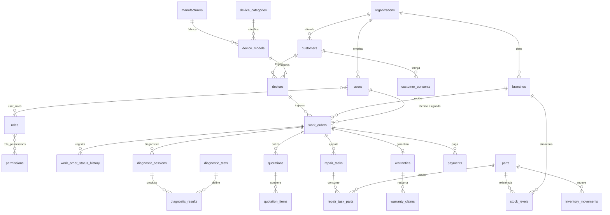

# ERMS – Modelo entidad-relación

Estado de cada entidad: **✅ migrada** · **📐 diseñada** (se migra en el sprint indicado).

Todas las tablas tienen `id UUID PK`, `created_at timestamptz` y `updated_at timestamptz`. Las
tablas de negocio tienen además `organization_id UUID NOT NULL FK → organizations` con índice.

## 1. Diagrama (núcleo)

## 2. Entidades

### Identidad y organización

| Tabla | Sprint | Columnas clave | Restricciones |
|---|---|---|---|
| `organizations` | ✅ 0 | name, slug, tax_id (NIT), timezone, is_active | `uq(slug)` |
| `branches` | 📐 1 | name, address, city, phone, is_active | `uq(organization_id, name)` |
| `users` | 📐 1 | email, full_name, password_hash, is_active, last_login_at | `uq(organization_id, email)` |
| `roles` | 📐 1 | code (ADMIN, SUPERVISOR, TECHNICIAN, RECEPTIONIST), name | `uq(organization_id, code)` |
| `permissions` | 📐 1 | code (`work_orders:create`), description | `uq(code)`; catálogo global |
| `user_roles`, `role_permissions` | 📐 1 | tablas puente | PK compuesta |
| `refresh_tokens` | 📐 1 | user_id, token_hash, expires_at, revoked_at, replaced_by_id | índice por token_hash |
| `password_reset_tokens` | 📐 1 | user_id, token_hash, expires_at, used_at | — |
| `audit_logs` | 📐 1 | actor_user_id, action, entity_type, entity_id, changes JSONB, ip, user_agent | solo inserción; índice (entity_type, entity_id) |

### Clientes y dispositivos

| Tabla | Sprint | Columnas clave | Restricciones |
|---|---|---|---|
| `customers` | 📐 2 | kind (PERSON/COMPANY), name, id_type (CC, CE, NIT, PAS, TI, PPT), id_number, phone, email, address, notes, status | `uq(organization_id, id_type, id_number)`; índice trigram por nombre |
| `customer_consents` | 📐 2 | customer_id, purpose (DATA_PROCESSING, DIAGNOSTIC_AGENT, PHOTOS), granted_at, revoked_at, evidence_attachment_id | Ley 1581 de 2012 |
| `manufacturers` | 📐 2 | name, is_active | `uq(organization_id, name)` |
| `device_categories` | 📐 2 | code, name | `uq(organization_id, code)` |
| `device_models` | 📐 2 | manufacturer_id, category_id, name, release_year | `uq(manufacturer_id, name)` |
| `devices` | 📐 2 | customer_id, model_id, serial_number, imei, os, capacity, color, notes | IMEI validado con Luhn; índices por serial e IMEI |

### Órdenes de servicio

| Tabla | Sprint | Columnas clave | Restricciones |
|---|---|---|---|
| `document_sequences` | 📐 3 | doc_type (WORK_ORDER, QUOTATION, …), year, last_value | `uq(organization_id, doc_type, year)`; `SELECT … FOR UPDATE` |
| `work_orders` | 📐 3 | number (`ER-2026-000001`), branch_id, customer_id, device_id, assigned_technician_id, status, received_at, reported_issue, physical_condition, accessories JSONB, notes | `uq(organization_id, number)`; índice por status |
| `work_order_status_history` | 📐 3 | work_order_id, from_status, to_status, changed_by, reason | solo inserción |
| `attachments` | 📐 3 | entity_type, entity_id, storage_key, file_name, content_type, size_bytes, sha256, uploaded_by | índice (entity_type, entity_id) |

**Estados de la orden:** `RECIBIDO`, `INSPECCION`, `DIAGNOSTICO`, `COTIZACION`,
`PENDIENTE_AUTORIZACION`, `APROBADO`, `COTIZACION_RECHAZADA` *(agregado)*, `EN_REPARACION`,
`CONTROL_CALIDAD`, `LISTO_ENTREGA`, `ENTREGADO`, `CANCELADO`, `NO_REPARABLE`.

Los estados `NO_REPARABLE`, `COTIZACION_RECHAZADA` y `CANCELADO` pasan a `LISTO_ENTREGA` y luego
a `ENTREGADO`, porque el equipo siempre se devuelve. La matriz completa de transiciones se
define en el Sprint 3.

### Diagnóstico

| Tabla | Sprint | Columnas clave |
|---|---|---|
| `diagnostic_tests` | 📐 4 | code, component, adapter, mode (AUTOMATED/MANUAL), description; catálogo |
| `checklist_templates` | 📐 4 | category_id, name, items JSONB (consolas, Apple) |
| `diagnostic_sessions` | 📐 4 | work_order_id, started_by, agent_version, consent_id, started_at, finished_at |
| `diagnostic_results` | 📐 4 | session_id, test_id, status (HEALTHY, WARNING, CRITICAL, NOT_TESTED, NOT_SUPPORTED), severity, tool, evidence JSONB, recommendation, source (AGENT, MANUAL, AI_SUGGESTION), executed_at |

`source = AI_SUGGESTION` nunca se presenta como resultado comprobado (Módulo 12).

### Reparación, inventario y comercial

| Tabla | Sprint | Columnas clave | Restricciones |
|---|---|---|---|
| `repair_tasks` | 📐 5 | work_order_id, technician_id, description, procedure, labor_minutes, status | — |
| `qc_checklists`, `qc_results` | 📐 5 | ítems requeridos por categoría; resultado por ítem | no se finaliza sin QC completo |
| `parts` | 📐 5 | sku, name, kind (PART, COMPONENT, ACCESSORY, CONSUMABLE), unit_cost, sale_price, min_stock | `uq(organization_id, sku)` |
| `suppliers` | 📐 5 | name, nit, contact, phone, email | — |
| `stock_levels` | 📐 5 | part_id, branch_id, quantity | `ck(quantity >= 0)`, `uq(part_id, branch_id)` |
| `inventory_movements` | 📐 5 | part_id, branch_id, type (IN, OUT, ADJUSTMENT, RETURN), quantity, unit_cost, reference_type, reference_id, created_by | solo inserción |
| `purchase_orders`, `purchase_order_items` | 📐 5 | supplier_id, status, items | — |
| `repair_task_parts` | 📐 5 | repair_task_id, part_id, quantity, movement_id | FK al movimiento que descontó el stock |
| `quotations` | 📐 5 | work_order_id, number, version, status (DRAFT, SENT, ACCEPTED, REJECTED, EXPIRED), subtotal, discount_total, tax_total, total, discount_authorized_by | montos `NUMERIC(14,2)` |
| `quotation_items` | 📐 5 | quotation_id, kind (LABOR, PART), part_id, description, quantity, unit_price, discount, **tax_rate** (0 o 0.19) | IVA por ítem (ADR-010) |
| `payments` | 📐 5 | work_order_id, amount, method (CASH, TRANSFER, CARD, NEQUI, DAVIPLATA), reference, received_by, paid_at | `ck(amount > 0)` |
| `warranties` | 📐 6 | work_order_id, starts_at, ends_at, conditions | — |
| `warranty_claims` | 📐 6 | warranty_id, reported_issue, diagnosis, resolution, new_work_order_id | — |

**Transacción de consumo de repuestos (Sprint 5):** en una sola transacción se ejecuta
`SELECT … FOR UPDATE` sobre `stock_levels`, se valida la cantidad, se inserta el registro en
`inventory_movements` (OUT) y se inserta el registro en `repair_task_parts`. Si falta stock se
hace rollback completo.
